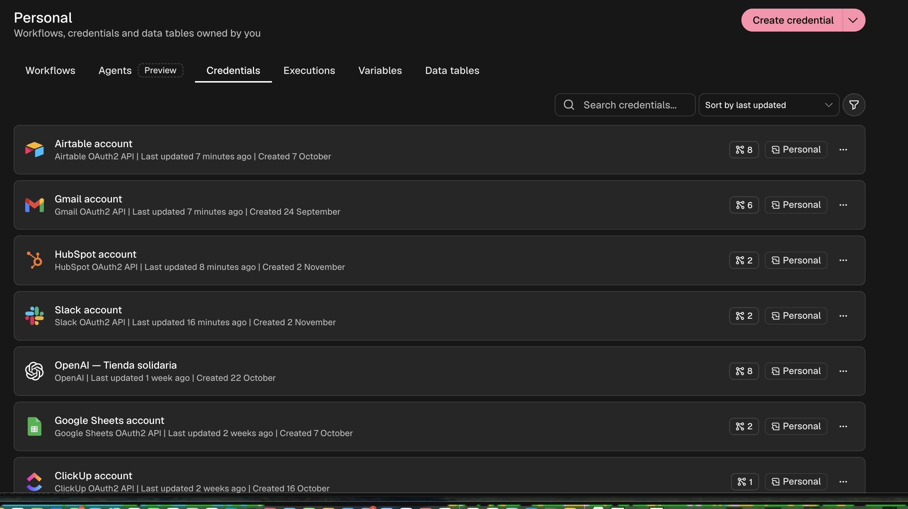

# Checkpoint 4 — Tienda Solidaria

Autora: Cecilia Risso Patron.

## Objetivo
Evolucionar el coordinador multiagente del módulo 3: recibir consultas por Gmail, conservar contexto en Airtable, buscar y registrar contactos en HubSpot, preparar un borrador de respuesta y avisar al equipo por Slack.

## Recorrido
Gmail → filtro de correos automáticos → lectura completa → preparación y validación → memoria Airtable y coordinador con especialistas → búsqueda de contacto en HubSpot → rama existente/nuevo → borrador Gmail → limpieza del aviso → Slack.

## Controles
- IF inmediato al disparador: descarta asuntos Auto-reply, Out of office, Undeliverable y remitentes no-reply.
- Validación básica del email y presencia de identificadores y texto antes de escribir datos.
- Búsqueda por email antes de escribir en HubSpot. Ambas ramas utilizan la operación nativa Create or Update.
- Gmail crea únicamente borradores; el envío requiere revisión y acción humana.
- Antes de Slack se conserva únicamente el aviso, sin historial ni adjuntos.
- La memoria identifica cada hilo mediante gmail:threadId. El resumen distingue propuestas de respuestas enviadas.

## Instalación y dependencias
Importar checkpoint4_cecilia_risso_patron.json en un workflow nuevo de n8n. Seleccionar las credenciales propias: Gmail OAuth2, HubSpot OAuth2, Slack OAuth2, Airtable OAuth2 y OpenAI.

El coordinador depende de los subworkflows M2 — Especialista de catálogo y M2 — Especialista de información de tienda. En otra instancia hay que importar esas dependencias y seleccionarlas en las herramientas del agente. La memoria utiliza la tabla Memoria_Tienda_Solidaria de Airtable con Session_ID, Fecha de actualización, Resumen Consolidado, Estado del caso y Datos clave.

## Configuración de ensayo
El disparador filtra subject:M4-PRUEBA y procesa un correo por consulta. Este límite es intencional: varias expresiones heredadas utilizan first(). No ampliar el lote sin adaptar y probar el aislamiento entre mensajes. El workflow se entrega inactivo. El filtro de asunto debe ajustarse para uso real.

## Credenciales
Las conexiones del flujo utilizan OAuth2 para Gmail, HubSpot y Slack. La ejecución de prueba llegó hasta la creación del borrador y la publicación del aviso en Slack.

La captura muestra la lista de conexiones, sin tokens ni secretos. Las referencias del JSON no transfieren las autorizaciones a otra instancia. No se ha auditado todavía el alcance efectivo de los permisos OAuth concedidos.

## Verificación
Revisión estática completada: 28 nodos, referencias y conexiones coherentes, sin nodos desactivados. Esto no acredita ejecución en n8n.

| Prueba | Estado |
| --- | --- |
| Correo normal → contacto → borrador → Slack | Ejecución reportada; capturas del 2/11/2026 17:24 confirman borrador Gmail y aviso Slack. Captura posterior confirma un contacto con el email de prueba en HubSpot; contenido de Message y rama Update pendientes de comprobar. |
| Mismo email → contacto existente sin duplicación | Pendiente |
| Misma conversación → recuperación de memoria | Pendiente |
| Auto-reply → interrupción antes de escrituras | Pendiente |
| Datos inválidos → interrupción antes de escrituras | Pendiente |
| Resumen y actualización de memoria | Pendiente |

## Límites
La memoria reciente depende de Simple Memory. Airtable se actualiza con el resumen cuando se supera el umbral configurado. Reejecutar manualmente el mismo correo puede crear otro borrador y otro aviso: no se implementó deduplicación de mensajes por messageId.
